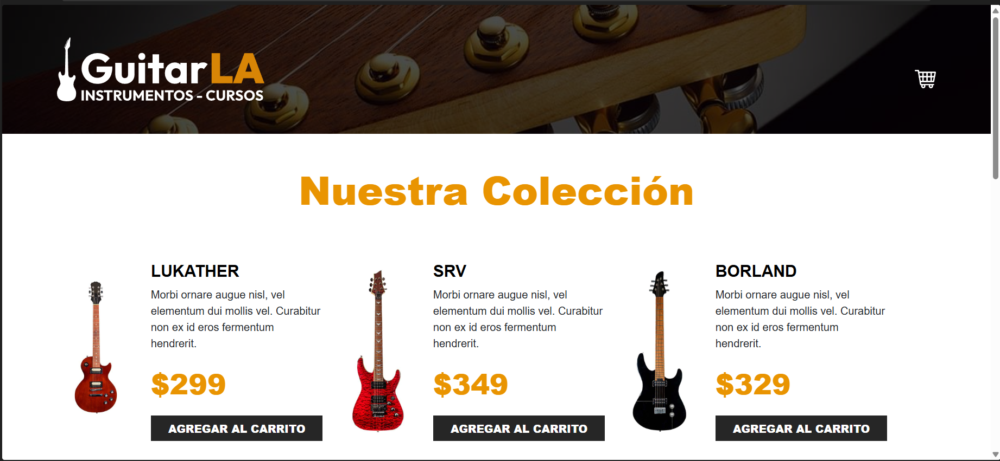
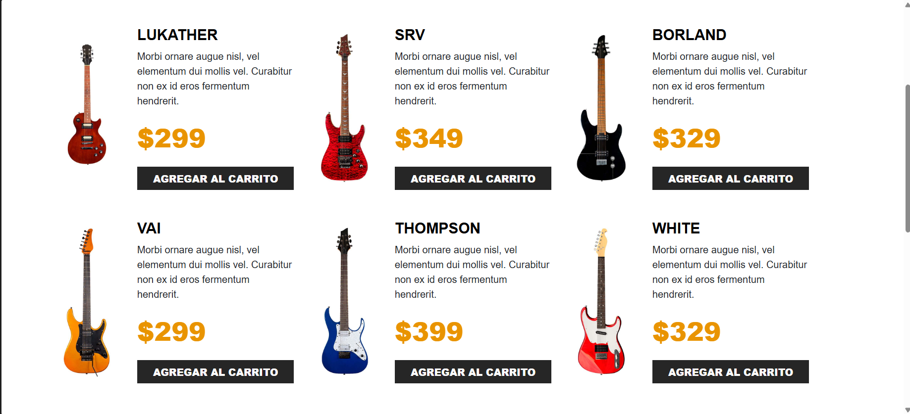
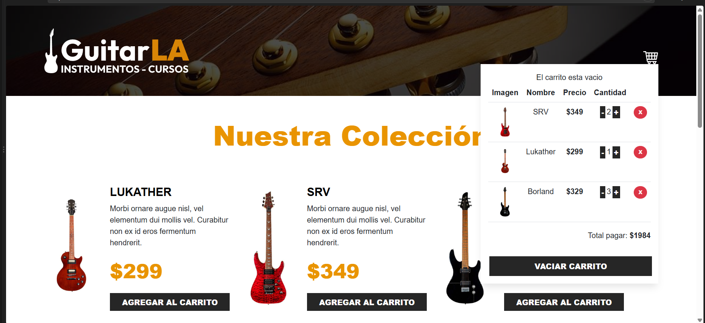

# GuitarsLA-ts

Aplicación web de una tienda de guitarras desarrollada con React y TypeScript. Permite visualizar una colección de instrumentos y administrar un carrito de compras mediante componentes reutilizables y un hook personalizado.

## Índice

1. [Visión General del Proyecto](#1-visión-general-del-proyecto)
2. [Ficha Técnica y Tecnologías](#2-ficha-técnica-y-tecnologías)
3. [Arquitectura e Implementación en React](#3-arquitectura-e-implementación-en-react)
4. [Patrones y Buenas Prácticas](#4-patrones-y-buenas-prácticas)
5. [Manejo de Estado y Persistencia](#5-manejo-de-estado-y-persistencia)
6. [Puesta en Marcha](#6-puesta-en-marcha)

---

# 1. Visión General del Proyecto

## 1.1 Nombre y propósito de la aplicación

**Nombre:** GuitarsLA-ts.

GuitarsLA-ts es una aplicación web que simula una tienda de guitarras. Su propósito es permitir que los usuarios consulten una colección de instrumentos, agreguen guitarras a un carrito, modifiquen las cantidades, eliminen productos y visualicen el total de su compra.

La aplicación se desarrolló utilizando React y TypeScript, organizando las funciones en componentes para facilitar la comprensión y el mantenimiento del código.

## 1.2 Problema que resuelve

La aplicación facilita la visualización y selección de guitarras dentro de una tienda digital. Además, permite organizar los productos elegidos en un carrito, consultar sus precios y calcular el importe correspondiente a las cantidades seleccionadas.

## 1.3 Funcionalidades principales

- Visualización de una colección de 12 guitarras.
- Presentación del nombre, imagen, descripción y precio de cada instrumento.
- Agregado de guitarras al carrito de compras.
- Incremento y disminución de las cantidades.
- Límite de cinco unidades al incrementar la cantidad desde el carrito.
- Eliminación individual de productos.
- Opción para vaciar el carrito.
- Cálculo del total de la compra.
- Conservación del carrito mediante `localStorage`.

## 1.4 Capturas de pantalla de la aplicación

### Página principal y colección de guitarras




### Carrito de compras



### Flujo de funcionamiento


## 1.5 Repositorio y despliegue

- **Repositorio de GitHub:** https://github.com/dayannardz/GuitarsLA-ts
- **Despliegue en producción:** No se cuenta con una URL de producción confirmada.

---

# 2. Ficha Técnica y Tecnologías

## 2.1 Lenguajes de programación

| Tecnología | Uso en el proyecto |
|---|---|
| TypeScript | Define los tipos de datos, las propiedades de los componentes y la estructura de los productos. |
| JavaScript ES6+ | Es la base de ejecución de la aplicación React y permite utilizar funciones, arreglos, métodos de objetos y funciones flecha. |
| TSX | Permite escribir componentes React combinando TypeScript con la estructura visual de JSX. |
| CSS | Define los estilos visuales de la aplicación. |

**Nivel de tipado:** tipado estático mediante TypeScript. Se utilizan tipos para representar guitarras, elementos del carrito y propiedades de los componentes. El nivel de estrictez general depende de la configuración de TypeScript del proyecto.

## 2.2 Framework y librerías de interfaz

| Tecnología | Función |
|---|---|
| React | Construcción de la interfaz mediante componentes funcionales. |
| React DOM | Renderizado de la aplicación en el navegador. |
| Bootstrap | Clases de diseño responsivo, distribución mediante filas y columnas, botones y estilos visuales. |
| CSS | Personalización de la presentación de la aplicación. |

La presencia de Bootstrap se identifica por las clases utilizadas en los componentes, como `container-xl`, `row`, `col-md-6`, `btn` y `text-center`. La dependencia y su versión exacta deben confirmarse en `package.json`.

## 2.3 Entorno de desarrollo y herramientas

| Herramienta | Función |
|---|---|
| Vite | Servidor de desarrollo y herramienta de compilación de la aplicación. |
| npm | Instalación y administración de dependencias, si es el gestor configurado en el proyecto. |
| Git | Control de versiones del código fuente. |
| GitHub | Alojamiento del repositorio remoto. |
| Visual Studio Code | Editor de código utilizado para desarrollar y modificar los archivos. |

Las versiones exactas de React, TypeScript, Vite, Node.js y npm deben verificarse en los archivos de configuración y en el entorno de desarrollo.

## 2.4 Dependencias clave

- `react`: permite crear componentes funcionales y utilizar hooks.
- `react-dom`: permite montar la aplicación React en el navegador.
- `typescript`: proporciona tipado estático al código.
- `vite`: facilita la ejecución del entorno local y la compilación.
- `bootstrap`: proporciona clases para organizar la interfaz y aplicar estilos.

No se utiliza un cliente HTTP ni una librería de enrutamiento en el código compartido. La colección de guitarras se obtiene de un arreglo local definido en `db.ts`.

---

# 3. Arquitectura e Implementación en React

## 3.1 Organización de la aplicación

La aplicación está organizada en componentes, datos, tipos y lógica reutilizable.

La estructura lógica identificada en el código es la siguiente:

```text
GuitarsLA-ts/
├── caps/
│   ├── carrito-de-compras.png
│   ├── funcionamiento.gif
│   ├── pagina-principal-2.png
│   └── pagina-principal.png
├── public/
│   └── img/
├── docs/
│   ├── captura-principal.png
│   ├── captura-carrito.png
│   └── demo-guitarsla.gif
├── src/
│   ├── components/
│   │   ├── Guitar.tsx
│   │   └── Header.tsx
│   ├── data/
│   │   └── db.ts
│   ├── hooks/
│   │   └── useCart.ts
│   ├── App.tsx
│   ├── index.css
│   ├── main.tsx
│   └── types.ts
├── package.json
├── tsconfig.json
├── vite.config.ts
└── README.md
```

Esta estructura es ilustrativa y representa la organización lógica del código compartido. Los nombres y las ubicaciones definitivas deberán coincidir con los archivos reales del repositorio.

## 3.2 Hooks nativos de React

Los hooks permiten manejar el estado y ejecutar determinadas operaciones dentro de los componentes funcionales. En este proyecto se utilizan `useState`, `useEffect` y `useMemo`.

### 3.2.1 useState

**Función:** permite guardar información que cambia durante el uso de la aplicación y actualizar la interfaz cuando esos datos cambian.

En el hook personalizado `useCart` se utiliza para manejar:

- `data`: colección de guitarras disponible para mostrar.
- `cart`: productos agregados al carrito y sus cantidades.
- `auth`: estado booleano declarado en el código, aunque actualmente no participa en las funcionalidades implementadas.
- `total`: estado numérico declarado, aunque el total mostrado se obtiene mediante `calculateTotal()`.

**Justificación:** `useState` permite actualizar el carrito cuando se agrega, elimina o modifica un producto, provocando que React vuelva a representar la información actualizada.

### 3.2.2 useEffect

**Función:** permite ejecutar efectos secundarios después del renderizado cuando se cumplen determinadas condiciones.

En `useCart` se utiliza para guardar el carrito en el almacenamiento local del navegador:

```tsx
useEffect(() => {
  window.localStorage.setItem(
    "cart",
    JSON.stringify(cart)
  );
}, [cart]);
```

El efecto se ejecuta cuando cambia `cart`, convirtiendo el arreglo en una cadena JSON para guardarlo en `localStorage`.

También existe otro `useEffect` que imprime el contenido del carrito en la consola cuando cambia. Esta operación sirve como apoyo para revisar el funcionamiento durante el desarrollo.

**Justificación:** se utiliza para sincronizar el estado del carrito con el almacenamiento del navegador y facilitar la conservación de los productos seleccionados después de recargar la página.

### 3.2.3 useMemo

**Función:** memoriza el resultado de un cálculo mientras sus dependencias no cambien.

En `useCart` se utiliza para determinar si el carrito está vacío:

```tsx
const isEmpty = useMemo(
  () => cart.length === 0,
  [cart]
);
```

El valor `isEmpty` se utiliza en el componente `Header` para decidir si se muestra el mensaje de carrito vacío o la tabla con los productos seleccionados.

**Justificación:** permite obtener un valor derivado del estado del carrito y mantenerlo actualizado cuando cambia la lista de productos.

En este caso, el cálculo es sencillo y `useMemo` no es indispensable para el rendimiento; su función principal es memorizar el valor derivado.

### 3.2.4 useRef

`useRef` permite conservar referencias entre renderizados y acceder a elementos del DOM sin provocar un nuevo renderizado al modificar la referencia.

**Uso en el proyecto:** no se encuentra implementado en el código compartido.

No se incorpora porque las funciones actuales del carrito no requieren una referencia directa a un elemento del DOM.

### 3.2.5 useCallback

`useCallback` permite memorizar una función entre renderizados, algo que puede ser útil al pasar funciones a componentes optimizados o al utilizarlas como dependencias de otros hooks.

**Uso en el proyecto:** no se encuentra implementado en el código compartido.

Las funciones del carrito se definen directamente dentro de `useCart`, por lo que actualmente no se ha incorporado esta optimización.

### 3.2.6 useContext y useReducer

`useContext` permite compartir información entre componentes sin tener que pasar propiedades por cada nivel de la estructura.

`useReducer` permite organizar actualizaciones de estado mediante acciones y una función reductora, especialmente cuando existen muchas operaciones relacionadas.

**Uso en el proyecto:** ninguno de estos hooks se encuentra implementado en el código compartido.

El estado del carrito se administra mediante `useState` dentro de `useCart`, y sus métodos se entregan a los componentes a través de propiedades.

---

## 3.3 Custom Hooks 

### 3.3.1 useCart

**Archivo:** `src/hooks/useCart.ts` (ruta provisional basada en los imports compartidos).

`useCart` es un hook personalizado que concentra la lógica relacionada con el carrito de compras. Su propósito es separar las operaciones de los productos de la estructura visual de los componentes.

### Lógica encapsulada

El hook contiene las operaciones necesarias para administrar los productos seleccionados, calcular el total y sincronizar el carrito con el navegador.

Sus principales funciones son:

| Método o valor | Función |
|---|---|
| `handlerClick(item)` | Agrega una guitarra al carrito. Si ya existe, incrementa su cantidad. |
| `increaseQuantity(id)` | Incrementa la cantidad de un producto hasta un máximo de cinco unidades. |
| `decreaseQuantity(id)` | Disminuye la cantidad y elimina el producto cuando llega a una unidad y se solicita disminuirlo. |
| `removeFromCart(id)` | Elimina un producto del carrito mediante su identificador. |
| `emptyCart()` | Vacía todos los productos seleccionados. |
| `calculateTotal()` | Calcula el importe total multiplicando el precio por la cantidad de cada producto. |
| `isEmpty` | Indica si el carrito no contiene productos. |
| `cart` | Contiene los productos seleccionados. |
| `data` | Contiene la colección de guitarras disponible. |
| `setCart` | Permite actualizar directamente el estado del carrito. |

### Reutilización y desacoplamiento

En `App.tsx` se importa `useCart` y se utilizan sus valores y métodos para conectar la colección de guitarras con el carrito.

El componente `Guitar` recibe `handlerClick` como propiedad, mientras que `Header` recibe los productos seleccionados y las funciones para modificar el carrito.

Esta organización permite mantener las operaciones del carrito separadas de la presentación visual.

**Nota técnica:** aunque `useCart` está diseñado para encapsular la lógica, las funciones `handlerClick`, `increaseQuantity`, `decreaseQuantity`, `removeFromCart` y `emptyCart` están definidas dentro del hook y no se memorizan con `useCallback`.

---

## 3.4 Estructura de componentes

### 3.4.1 App

**Archivo:** `src/App.tsx`.

`App` es el componente principal de la aplicación. Importa `Header`, `Guitar` y `useCart`.

Sus responsabilidades son:

- Obtener los datos y métodos del hook `useCart`.
- Mostrar el encabezado y el carrito.
- Recorrer la colección de guitarras mediante `map()`.
- Renderizar un componente `Guitar` por cada instrumento.
- Mostrar el pie de página de la tienda.

Este componente coordina la información que se comparte entre las diferentes partes de la interfaz.

### 3.4.2 Guitar

**Archivo:** `src/components/Guitar.tsx`.

`Guitar` es un componente principalmente presentacional. Recibe una guitarra y una función para agregarla al carrito mediante sus propiedades.

Muestra:

- Imagen de la guitarra.
- Nombre.
- Descripción.
- Precio.
- Botón para agregar el instrumento al carrito.

Al presionar el botón, ejecuta `handlerClick(guitar)` para solicitar que el producto sea agregado.

### 3.4.3 Header

**Archivo:** `src/components/Header.tsx`.

`Header` presenta el encabezado de la tienda y la interfaz del carrito.

Sus responsabilidades incluyen:

- Mostrar el logotipo y el icono del carrito.
- Mostrar el mensaje cuando el carrito está vacío.
- Mostrar una tabla con los productos seleccionados.
- Permitir aumentar o disminuir cantidades.
- Permitir eliminar productos.
- Mostrar el total calculado.
- Ofrecer un botón para vaciar el carrito.

La lógica principal de modificación de productos se encuentra en `useCart`, mientras que `Header` utiliza las funciones recibidas mediante propiedades.

### 3.4.4 db

**Archivo:** `src/data/db.ts` (ruta provisional basada en los imports compartidos).

Contiene un arreglo de objetos con los datos de las doce guitarras disponibles.

Cada guitarra contiene un identificador, nombre, imagen, descripción y precio. Los datos se utilizan para mostrar la colección inicial sin depender de un servidor o una base de datos externa.

### 3.4.5 main.tsx

Es el punto de entrada de la aplicación. Importa `StrictMode`, `createRoot`, los estilos globales y `App`.

Utiliza `createRoot` para montar la aplicación en el elemento HTML identificado como `root`. También envuelve `App` con `StrictMode`, una herramienta de React que ayuda a identificar ciertos problemas durante el desarrollo.

---

# 4. Patrones y Buenas Prácticas

## 4.1 Componentes inteligentes y presentacionales

La aplicación separa la coordinación de la interfaz de la representación visual.

**Componente coordinador: `App`**

Se encarga de obtener los valores del hook personalizado y conectar los componentes mediante propiedades.

**Componentes presentacionales: `Guitar` y `Header`**

`Guitar` presenta los datos de una guitarra y permite solicitar que se agregue al carrito. `Header` muestra el contenido del carrito y los controles para modificarlo.

Aunque `Header` contiene condiciones para mostrar información y ejecutar acciones, las operaciones principales de actualización se encuentran en `useCart`.

Esta separación facilita el mantenimiento del código y evita concentrar toda la interfaz y su lógica en un único componente.

## 4.2 Tipado de Props

El proyecto utiliza TypeScript para describir los datos que reciben los componentes.

### Tipo Guitar

Representa la estructura de una guitarra:

```tsx
type Guitar = {
  id: number;
  name: string;
  image: string;
  description: string;
  price: number;
};
```

### Tipo CartItem

Representa una guitarra que forma parte del carrito y añade la cantidad:

```tsx
type CartItem = Guitar & {
  quantity: number;
};
```

El operador `&` permite combinar los campos de `Guitar` con la propiedad `quantity`.

### Tipo GuitarProps

Define las propiedades que recibe el componente `Guitar`:

```tsx
type GuitarProps = {
  guitar: Guitar;
  handlerClick: (item: Guitar) => void;
};
```

Esto permite indicar que `guitar` debe contener los datos de un instrumento y que `handlerClick` debe ser una función que recibe una guitarra.

### Tipo CartProps

Define las propiedades utilizadas por `Header`, como el arreglo del carrito, las funciones para modificar cantidades, el total y el indicador de carrito vacío.

Este tipado ayuda a mantener una estructura consistente entre los componentes y facilita detectar errores al pasar propiedades.

## 4.3 Modularización

La aplicación divide su código en componentes, hooks, datos y tipos. Cada parte tiene una responsabilidad específica:

- Los componentes construyen la interfaz.
- El hook `useCart` administra las operaciones del carrito.
- El archivo `db.ts` contiene los datos iniciales.
- Los tipos de TypeScript describen la estructura de los datos y las propiedades.

Esta organización facilita localizar errores, modificar funcionalidades y reutilizar partes del sistema.

## 4.4 Inmutabilidad de datos

El proyecto utiliza operaciones como `map()`, `filter()` y el operador spread (`...`) para generar nuevos arreglos y objetos al actualizar el carrito.

Por ejemplo, al incrementar una cantidad se utiliza un nuevo objeto para representar el producto actualizado:

```tsx
return {
  ...item,
  quantity: item.quantity + 1,
};
```

Este patrón ayuda a que React detecte los cambios del estado y actualice la interfaz.

**Aspecto por mejorar:** en `handlerClick`, cuando la guitarra ya existe, se copia el arreglo, pero se modifica directamente el objeto contenido en él. Para mantener una inmutabilidad más consistente, convendría crear también un nuevo objeto para el producto modificado.

## 4.5 Separación de responsabilidades

El hook personalizado concentra las operaciones relacionadas con el carrito, mientras que los componentes se encargan de mostrar los datos y ofrecer controles al usuario.

Esta separación hace que las funciones de negocio sean más fáciles de localizar y modificar.

## 4.6 Manejo de cantidades

El hook define una cantidad mínima de una unidad y un máximo de cinco unidades para el incremento desde el carrito.

Cuando se solicita disminuir un producto que ya tiene una unidad, el producto se elimina en lugar de mantener una cantidad igual a cero.

La validación evita que las cantidades incrementadas desde el carrito superen el límite establecido.

---

# 5. Manejo de Estado y Persistencia

## 5.1 Estrategia de manejo del estado

La aplicación utiliza el estado local de React mediante `useState`, centralizando las operaciones principales en el hook personalizado `useCart`.

Los componentes reciben la información y los métodos mediante propiedades, sin utilizar Context API ni un gestor externo de estado en el código compartido.

El estado se utiliza para:

- Conservar la colección de guitarras.
- Registrar los productos agregados al carrito.
- Actualizar las cantidades.
- Eliminar productos.
- Vaciar el carrito.
- Determinar si el carrito está vacío.

El total se calcula mediante `calculateTotal()` a partir de los productos y sus cantidades.

## 5.2 Persistencia en el navegador

El proyecto utiliza `localStorage` para guardar el contenido del carrito.

### Recuperación inicial

La función `initialCart` obtiene el valor almacenado bajo la clave `cart`:

```tsx
const initialCart = () => {
  const localStorageCart =
    window.localStorage.getItem("cart");

  return localStorageCart
    ? JSON.parse(localStorageCart)
    : [];
};
```

El estado del carrito se inicializa utilizando esta función:

```tsx
const [cart, setCart] = useState(initialCart);
```

Esto permite recuperar los productos guardados al inicializar el estado de la aplicación.

### Guardado automático

Cada vez que cambia el carrito, un efecto actualiza el almacenamiento local:

```tsx
useEffect(() => {
  window.localStorage.setItem(
    "cart",
    JSON.stringify(cart)
  );
}, [cart]);
```

De esta manera, los cambios realizados en los productos se guardan en el navegador.

### Ventajas de la persistencia

- Conserva los productos seleccionados al recargar la página.
- Evita perder el carrito cuando se actualiza la pestaña.
- No requiere una base de datos externa para guardar el carrito local.

### Consideraciones

`localStorage` almacena datos en el navegador del usuario y no reemplaza una base de datos de una tienda real.

La implementación actual utiliza `JSON.parse()` para recuperar el carrito sin una validación adicional del contenido almacenado. Si los datos guardados fueran inválidos, podría producirse un error. Como mejora futura, se recomienda validar los datos y manejar posibles excepciones.

## 5.3 Manejo de estados asíncronos

En el código compartido, la colección de guitarras se obtiene de un arreglo local y las operaciones del carrito se realizan en el navegador. No se observan peticiones HTTP ni llamadas a una API externa.

Por ello, actualmente no se necesita un estado de carga para obtener productos desde un servidor.

Los estados que sí se manejan son:

- **Carrito vacío:** se identifica mediante `isEmpty` y permite mostrar un mensaje cuando no hay productos.
- **Carrito con productos:** muestra la tabla con las guitarras seleccionadas y sus cantidades.
- **Actualización del carrito:** las modificaciones realizadas mediante los métodos del hook actualizan el estado y la interfaz.

No se identifican estados explícitos de `loading`, `error` o `success` para peticiones asíncronas, ya que no se observan operaciones de este tipo en la implementación compartida.

---

# 6. Puesta en Marcha

## 6.1 Requisitos previos

Para ejecutar el proyecto se necesita:

- Git instalado.
- Node.js en una versión compatible con las dependencias.
- npm, si está configurado como gestor de paquetes.
- Un editor de código como Visual Studio Code.
- Acceso al repositorio de GitHub.

Las versiones recomendadas deberán ajustarse a las dependencias y a la configuración real del proyecto.

## 6.2 Clonar el repositorio

Abrir una terminal y ejecutar:

```bash
git clone https://github.com/dayannardz/GuitarsLA-ts.git
```

## 6.3 Entrar a la carpeta del proyecto

```bash
cd GuitarsLA-ts
```

## 6.4 Instalar las dependencias

Ejecutar el siguiente comando en la carpeta donde se encuentra `package.json`:

```bash
npm install
```

Este comando instala las dependencias definidas en el proyecto.

## 6.5 Configurar variables de entorno

En el código compartido no se identifican variables de entorno ni conexiones a servicios externos que requieran claves de acceso.

Por ello, no se necesita configurar un archivo `.env` para las funciones actuales del carrito.

Si en el futuro se incorporan servicios externos, sus variables deberán documentarse y mantenerse fuera del repositorio cuando contengan información privada.

## 6.6 Ejecutar el entorno local

Si el archivo `package.json` contiene el script `dev` de Vite, ejecutar:

```bash
npm run dev
```

La terminal mostrará una dirección local. Abrirla en el navegador para visualizar la aplicación.

## 6.7 Ejecutar la compilación de producción

Para verificar la compilación del proyecto, ejecutar:

```bash
npm run build
```

Si el script `build` está configurado correctamente, se generará una versión optimizada de la aplicación.

## 6.8 Revisar el resultado

Una vez iniciada la aplicación, comprobar lo siguiente:

1. La colección de guitarras se muestra correctamente.
2. Los botones permiten agregar guitarras al carrito.
3. Las cantidades pueden incrementarse y disminuirse.
4. El carrito permite eliminar productos y vaciarse.
5. El total se actualiza al modificar los productos.
6. El carrito conserva sus datos después de recargar la página, siempre que el almacenamiento local contenga datos válidos.

---

# Conclusión

GuitarsLA-ts es una aplicación frontend que utiliza React y TypeScript para mostrar una colección de guitarras y administrar un carrito de compras.

La implementación de componentes funcionales permite dividir la interfaz en partes reutilizables. El hook personalizado `useCart` concentra las operaciones del carrito, mientras que `useState`, `useEffect` y `useMemo` permiten administrar el estado, conservar información en el navegador y determinar si existen productos seleccionados.

La documentación de estas decisiones técnicas facilita la comprensión del sistema, su mantenimiento y la incorporación de nuevas funcionalidades.
